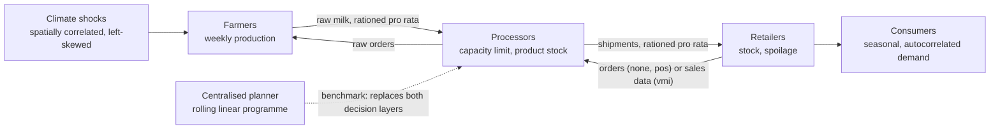
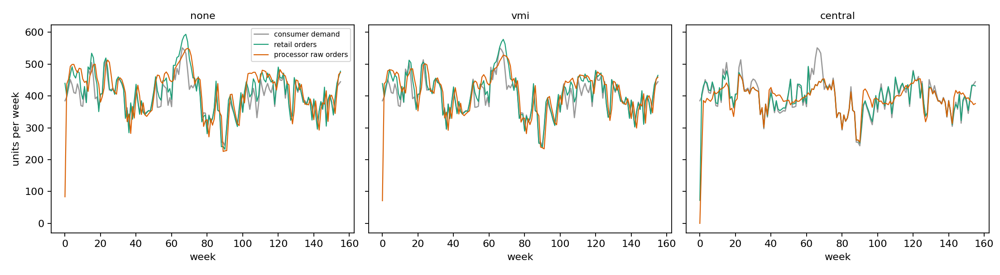
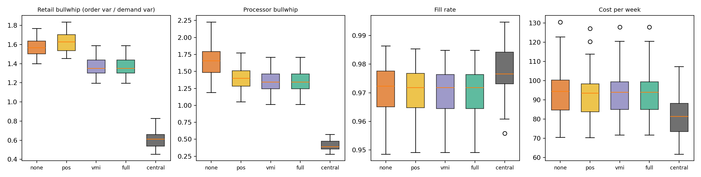
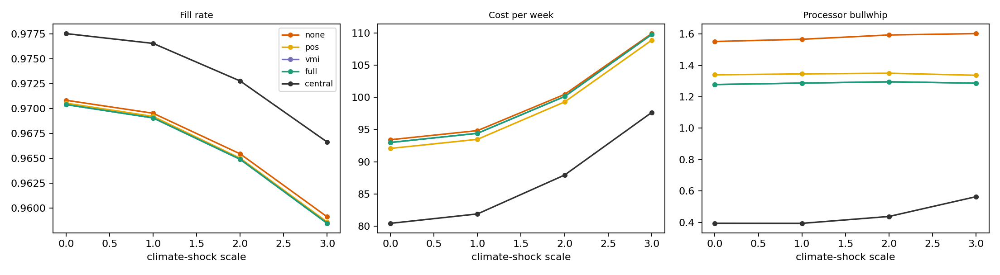
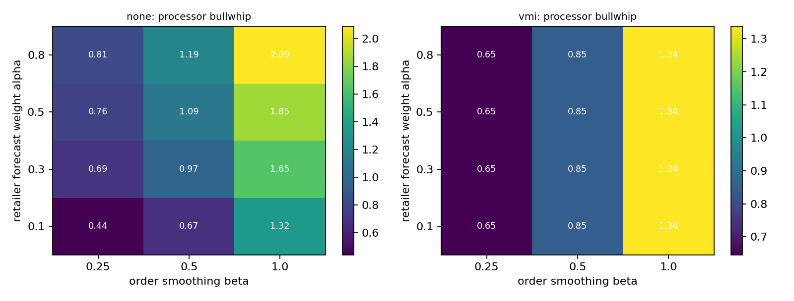
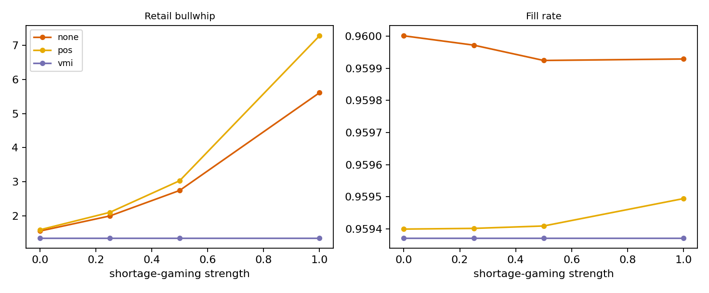
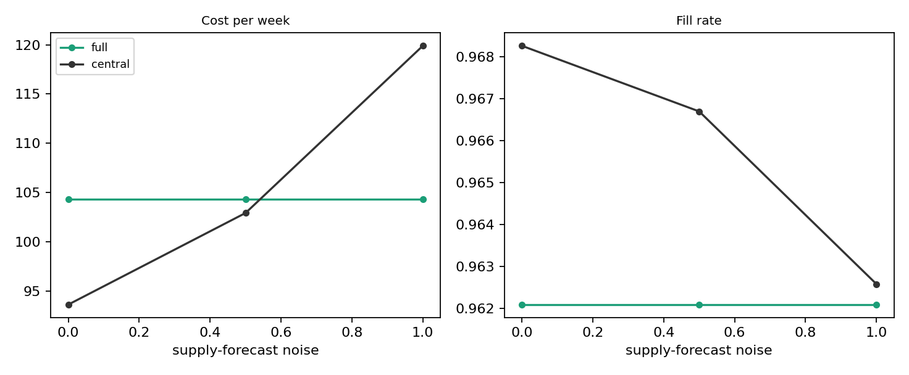
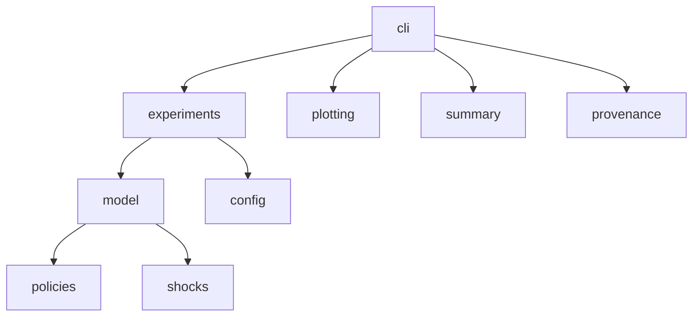

<div align="center">

# agrifood-agent-based-supply-chain

**Ordering rules, information sharing and the bullwhip effect in an agri-food supply chain under climate shocks**

A deterministic agent-based simulation of farmers, processors and retailers, compared against a centralised planner


[](https://github.com/meelad-sultan/agrifood-agent-based-supply-chain/actions/workflows/ci.yml)

</div>

> **Scope and status**
> - **What this is:** a reproducible simulation study with tests and fixed seeds: how ordering rules, information sharing and climate shocks interact in a stylised dairy-type chain.
> - **Inputs:** all parameters are **illustrative**, not calibrated to any firm or dataset ([`data/parameters.csv`](data/parameters.csv)). The climate-shock process is the one used in the companion repository `agrifood-supply-chain-climate-risk`.
> - **Agents:** simple fixed rules (forecast, base-stock, rationing). No learning, pricing or negotiation, and no language-model agents.
> - **Use:** results show how the model behaves, not what a real chain will do.

## Contents
1. [Why this project](#1-why-this-project) · 2. [Model](#2-the-model) · 3. [Experiments](#3-experiments) · 4. [Results](#4-results) · 5. [Quickstart](#5-quickstart) · 6. [Reproducing](#6-reproducing-the-study) · 7. [Configuration and outputs](#7-configuration-and-outputs) · 8. [API](#8-python-api) · 9. [Testing](#9-testing-and-ci) · 10. [Structure](#10-repository-structure) · 11. [Limitations](#11-limitations) · 12. [Roadmap](#12-roadmap) · 13. [Citation](#13-citation-licence-references)

## 1. Why this project
Small swings in consumer demand become large swings in orders further up a supply chain, the **bullwhip effect** (Forrester 1958; Lee, Padmanabhan and Whang 1997). In agri-food chains production is seasonal, milk is perishable and climate shocks hit several farms at once. This repository builds a small agent-based model and asks:
1. How much does each step up an **information-sharing ladder** (nothing, sales data, vendor-managed replenishment, a shared climate early warning) change bullwhip, service and cost?
2. What is the **price of decentralisation** relative to a centralised planner?
3. How do **reactive forecasting, order smoothing and shortage gaming** change the picture?
4. How much does **tuning the ordering rules** matter compared with the information regime?

It extends the companion repository `agrifood-supply-chain-climate-risk`, which designs the chain under climate risk, to how the chain is **operated** week by week.

## 2. The model


Retailers sell to consumers (unmet demand is lost), forecast demand by exponential smoothing and order up to `forecast x cover + z x sd x sqrt(cover)`, optionally smoothing orders (`beta`) and inflating them after a rationed shipment (`gaming`). Processors order raw milk with the same rule and ship pro rata to their retailers when stock is short. Farmers produce a seasonal quantity scaled by the climate shock of the year and deliver pro rata when orders exceed production. Retail stock spoils at 5 % a week, processor stock at 1 %. The chain has 6 farmers, 3 processors and 4 retailers.

| Regime | What is added | Decision rights |
|---|---|---|
| `none` | nothing: processors forecast from the orders they receive | retailers order |
| `pos` | processors forecast from consumer sales (point-of-sale data) | retailers order |
| `vmi` | processors manage replenishment from pooled sales data (vendor-managed inventory) | processors decide |
| `full` | `vmi` plus a shared forecast of coming supply shortfalls, with a tunable weight | processors decide |
| `central` | one planner with flexible shipping solves a rolling six-week linear programme | planner decides |

The planner knows the demand distribution and the (possibly noisy) supply forecast and may ship from any processor to any retailer, so it bundles **information, allocation and network flexibility**; the study does not separate them. Formulas: [`docs/method.md`](docs/method.md). Metrics: bullwhip ratio (variance of orders divided by variance of consumer demand), fill rate, weekly cost (holding, shortage, spoilage, wasted raw milk); the first 26 weeks are ignored.

## 3. Experiments
| ID | Experiment | Design |
|---|---|---|
| E1 | Regime comparison | 30 simulated 156-week worlds, baseline climate shocks, tuned and untuned settings |
| E2 | Climate-shock severity | shock scale 0, 1, 2, 3; 20 worlds each; tuned per scale |
| E3 | Forecast reactivity and order smoothing | retailer smoothing weight x order smoothing, regimes `none` and `vmi`; 15 worlds per cell |
| E4 | Shortage gaming | strength 0 to 1 under strong shocks, regimes `none`, `pos`, `vmi`; 20 worlds |
| E5 | Shared supply-forecast quality | noise 0, 0.5, 1 under strong shocks, regimes `full` and `central`; tuned per noise level; 20 worlds |

Every regime is **tuned in every condition** (base-stock cover, safety factor and, for `full`, the early-warning weight) on separate calibration worlds, and all regimes see the **same simulated world** (common random numbers).

## 4. Results
Environment: Python 3.12.3, NumPy 2.4.4, SciPy 1.17.1, pandas 3.0.2. Full tables: [`results/metrics/summary.md`](results/metrics/summary.md). The default study takes a few minutes on one core.

### 4.1 Headline numbers (E1, tuned settings; median over worlds)
| Regime | Fill rate | Retail bullwhip | Processor bullwhip | Cost per week |
|---|---|---|---|---|
| none | 0.972 | 1.57 | 1.66 | 94.4 |
| pos | 0.972 | 1.63 | 1.40 | 93.5 |
| vmi | 0.972 | 1.35 | 1.34 | 94.0 |
| full | 0.972 | 1.35 | 1.34 | 94.0 |
| central | 0.977 | 0.61 | 0.39 | 81.3 |

| | |
|---|---|
|  |  |
| **Fig. 1.** One world: demand, retail orders, processor orders | **Fig. 2.** Regimes across worlds |
|  |  |
| **Fig. 3.** Climate-shock severity | **Fig. 4.** Processor bullwhip by retailer reactivity and order smoothing |
|  |  |
| **Fig. 5.** Shortage gaming | **Fig. 6.** Shared supply-forecast quality |

<details>
<summary><b>Full tables (tuned settings, paired differences, cost components, all experiments)</b></summary>

######## Tuned settings per condition (each regime is tuned separately, on calibration worlds with separate seeds)

| condition | regime | cover (weeks) | safety factor z | early-warning weight theta | calibration cost/week |
|---|---|---|---|---|---|
| scale=1.0 | none | 1.0 | 1.28 | nan | 86.0 |
| scale=1.0 | pos | 1.0 | 1.28 | nan | 85.0 |
| scale=1.0 | vmi | 1.0 | 1.28 | nan | 85.8 |
| scale=1.0 | full | 1.0 | 1.28 | 0.0 | 85.8 |
| scale=1.0 | central | nan | 1.28 | nan | 76.7 |
| scale=0.0 | none | 1.0 | 1.28 | nan | 85.7 |
| scale=0.0 | pos | 1.0 | 1.28 | nan | 84.7 |
| scale=0.0 | vmi | 1.0 | 1.28 | nan | 85.5 |
| scale=0.0 | full | 1.0 | 1.28 | 0.0 | 85.5 |
| scale=0.0 | central | nan | 1.28 | nan | 76.6 |
| scale=2.0 | none | 1.0 | 1.28 | nan | 88.5 |
| scale=2.0 | pos | 1.0 | 1.28 | nan | 87.4 |
| scale=2.0 | vmi | 1.0 | 1.28 | nan | 88.2 |
| scale=2.0 | full | 1.0 | 1.28 | 0.0 | 88.2 |
| scale=2.0 | central | nan | 1.28 | nan | 77.7 |
| scale=3.0 | none | 1.0 | 1.28 | nan | 98.6 |
| scale=3.0 | pos | 1.0 | 1.28 | nan | 97.9 |
| scale=3.0 | vmi | 1.0 | 1.28 | nan | 98.6 |
| scale=3.0 | full | 1.0 | 1.28 | 0.0 | 98.6 |
| scale=3.0 | central | nan | 1.28 | nan | 88.5 |
| scale=3.0|noise=0.0 | full | 1.0 | 1.28 | 0.0 | 98.6 |
| scale=3.0|noise=0.0 | central | nan | 1.28 | nan | 88.5 |
| scale=3.0|noise=0.5 | full | 1.0 | 1.28 | 0.0 | 98.6 |
| scale=3.0|noise=0.5 | central | nan | 1.65 | nan | 93.6 |
| scale=3.0|noise=1.0 | full | 1.0 | 1.28 | 0.0 | 98.6 |
| scale=3.0|noise=1.0 | central | nan | 1.0 | nan | 106.3 |

######## E1: information regimes at their tuned settings (median [IQR] over worlds)

| regime | fill rate | bullwhip retail | bullwhip processor | cost / week | stockout weeks |
|---|---|---|---|---|---|
| none | 0.972 [0.965, 0.978] | 1.57 [1.50, 1.63] | 1.66 [1.48, 1.79] | 94.4 [84.7, 100.3] | 0.42 [0.39, 0.47] |
| pos | 0.972 [0.965, 0.977] | 1.63 [1.54, 1.70] | 1.40 [1.28, 1.51] | 93.5 [83.8, 98.3] | 0.43 [0.39, 0.46] |
| vmi | 0.972 [0.965, 0.976] | 1.35 [1.30, 1.44] | 1.34 [1.24, 1.46] | 94.0 [85.1, 99.4] | 0.42 [0.39, 0.46] |
| full | 0.972 [0.965, 0.976] | 1.35 [1.30, 1.44] | 1.34 [1.24, 1.46] | 94.0 [85.1, 99.4] | 0.42 [0.39, 0.46] |
| central | 0.977 [0.973, 0.984] | 0.61 [0.54, 0.66] | 0.39 [0.35, 0.47] | 81.3 [73.5, 88.1] | 0.42 [0.36, 0.47] |

######## Paired differences against `none` (mean [95 % bootstrap interval] over worlds)

| regime | fill rate | bullwhip retail | bullwhip processor | cost / week |
|---|---|---|---|---|
| pos | -0.000 [-0.001, -0.000] | +0.05 [+0.04, +0.06] | -0.25 [-0.28, -0.22] | -1.3 [-1.7, -0.9] |
| vmi | -0.000 [-0.001, -0.000] | -0.20 [-0.22, -0.19] | -0.31 [-0.34, -0.28] | -0.7 [-1.1, -0.2] |
| full | -0.000 [-0.001, -0.000] | -0.20 [-0.22, -0.19] | -0.31 [-0.34, -0.28] | -0.7 [-1.1, -0.2] |
| central | +0.007 [+0.006, +0.008] | -0.97 [-1.03, -0.92] | -1.25 [-1.32, -1.18] | -12.4 [-14.3, -10.3] |

######## Price of decentralisation: cost per week relative to the centralised planner (mean excess in %, 95 % interval)

| regime | excess cost (%) |
|---|---|
| none | +15.2 [+12.9, +17.4] |
| pos | +13.6 [+11.5, +15.8] |
| vmi | +14.4 [+12.2, +16.6] |
| full | +14.4 [+12.2, +16.6] |

######## Cost components per week (tuned, mean)

| regime | hold | short | spoil | waste |
|---|---|---|---|---|
| none | 30.5 | 47.1 | 3.8 | 13.3 |
| pos | 28.6 | 47.8 | 3.6 | 13.3 |
| vmi | 29.3 | 47.7 | 3.7 | 13.3 |
| full | 29.3 | 47.7 | 3.7 | 13.3 |
| central | 30.7 | 36.1 | 3.8 | 11.7 |

######## Same regimes with the untuned default settings (cover 2 weeks, z 1.28; mean), to show how much tuning matters

| regime | fill_rate | bullwhip_retail | bullwhip_proc | cost_per_week |
|---|---|---|---|---|
| none | 0.976 | 8.545 | 2.468 | 255.151 |
| pos | 0.975 | 8.762 | 2.53 | 246.535 |
| vmi | 0.975 | 8.036 | 2.385 | 247.319 |
| full | 0.974 | 8.029 | 2.663 | 249.796 |
| central | 0.977 | 0.606 | 0.407 | 82.318 |

######## E2: climate-shock severity (mean over worlds): fill rate / cost per week

| shock_scale | none | pos | vmi | full | central |
|---|---|---|---|---|---|
| 0.0 | 0.971 / 93.4 | 0.971 / 92.1 | 0.970 / 93.0 | 0.970 / 93.0 | 0.978 / 80.4 |
| 1.0 | 0.970 / 94.8 | 0.969 / 93.5 | 0.969 / 94.4 | 0.969 / 94.4 | 0.977 / 81.9 |
| 2.0 | 0.965 / 100.5 | 0.965 / 99.3 | 0.965 / 100.1 | 0.965 / 100.1 | 0.973 / 87.9 |
| 3.0 | 0.959 / 109.9 | 0.959 / 108.9 | 0.958 / 109.8 | 0.958 / 109.8 | 0.967 / 97.6 |

######## E3: processor bullwhip by retailer forecast reactivity (rows) and order smoothing beta (columns), mean over worlds

Regime **none**

| alpha_retailer | 0.25 | 0.5 | 1.0 |
|---|---|---|---|
| 0.1 | 0.44 | 0.67 | 1.32 |
| 0.3 | 0.69 | 0.97 | 1.65 |
| 0.5 | 0.76 | 1.09 | 1.85 |
| 0.8 | 0.81 | 1.19 | 2.09 |

Regime **vmi**

| alpha_retailer | 0.25 | 0.5 | 1.0 |
|---|---|---|---|
| 0.1 | 0.65 | 0.85 | 1.34 |
| 0.3 | 0.65 | 0.85 | 1.34 |
| 0.5 | 0.65 | 0.85 | 1.34 |
| 0.8 | 0.65 | 0.85 | 1.34 |

######## E4: shortage gaming (order inflation after a rationed shipment), strong climate stress: retail bullwhip / fill rate (mean)

| gaming | none | pos | vmi |
|---|---|---|---|
| 0.0 | 1.55 / 0.960 | 1.59 / 0.959 | 1.35 / 0.959 |
| 0.25 | 1.99 / 0.960 | 2.10 / 0.959 | 1.35 / 0.959 |
| 0.5 | 2.74 / 0.960 | 3.03 / 0.959 | 1.35 / 0.959 |
| 1.0 | 5.61 / 0.960 | 7.29 / 0.959 | 1.35 / 0.959 |

######## E5: quality of the shared supply forecast (noise as a fraction of expected supply), strong climate stress: cost per week / fill rate (mean)

| forecast_noise | central | full |
|---|---|---|
| 0.0 | 93.6 / 0.968 | 104.3 / 0.962 |
| 0.5 | 102.9 / 0.967 | 104.3 / 0.962 |
| 1.0 | 119.9 / 0.963 | 104.3 / 0.962 |

</details>

### 4.2 What the results show
1. **Tuning matters.** With the untuned default (cover 2 weeks) retail bullwhip is 8.5 and cost 255 per week for `none`; tuned, they are 1.6 and 95. Tuning chose a cover of 1 week(s) and a safety factor of 1.28 for the decentralised regimes across all conditions (see the tuned-settings table).
2. **Information sharing changes cost by 0.7 % to 1.4 %.** Against `none` (paired mean and 95 % interval), cost per week changes by -1.3 [-1.7, -0.9] for `pos` and -0.7 [-1.1, -0.2] for `vmi`; fill rate by -0.000 [-0.001, -0.000] and -0.000 [-0.001, -0.000]. Processor bullwhip changes by -0.25 [-0.28, -0.22] (`pos`) and -0.31 [-0.34, -0.28] (`vmi`); retail bullwhip by +0.05 [+0.04, +0.06] and -0.20 [-0.22, -0.19]. Sales data alone leaves the retailers' ordering rule unchanged, so any change in retail orders comes only through rationing feedback; only when processors take over replenishment (`vmi`) does the rule itself change.
3. **The value of vendor-managed inventory depends on retailers' reactivity** (an assumption of the model): with a retailer smoothing weight of 0.5 and no order smoothing, processor bullwhip is 1.85 under `none` against 1.34 under `vmi`; with a sluggish weight of 0.1 they are 1.32 and 1.34.
4. **Shortage gaming** (strength 0 to 1, strong shocks) moves retail bullwhip from 1.6 to 5.6 under `none` and from 1.6 to 7.3 under `pos`, with fill rate 0.960 and 0.960. `vmi` is unaffected by construction because retailers place no orders.
5. **Centralised planning:** cost per week is -12.4 [-14.3, -10.3] against `none` (13 to 15 % more for the decentralised regimes relative to the planner), fill rate +0.007 [+0.006, +0.008], retail bullwhip 0.61. This bundles information, allocation and network flexibility.
6. **Climate shocks** (scale 0 to 3): cost per week for `none` moves from 93 to 110 and for `central` from 80 to 98; fill rate for `none` from 0.971 to 0.959.
7. **Shared supply forecast:** the tuning grid included an early-warning weight from 0 upward; it chose 0 in every condition, so `full` is identical to `vmi` and `full` is flat in forecast quality. A better early-warning rule could still help; the simple stock-building rule used here did not. The planner's cost per week moves from 94 to 120 as forecast noise goes from 0 to 100 % of expected supply.

### 4.3 What the results do **not** show
- **Nothing is calibrated.** Parameters, cost weights and the retailer forecasting assumption are illustrative; absolute numbers are not estimates for any real chain.
- **The planner's advantage is not decomposed** into information, who decides, and shipping flexibility.
- **Tuning is modest:** a small grid on 6 calibration worlds per condition.
- **The early-warning rule is simple;** whether a better rule would help is untested.
- **Many weeks show a small shortfall** (stockout weeks in the table) while fill rate stays high; this follows from the cost weights.

## 5. Quickstart
```bash
git clone https://github.com/meelad-sultan/agrifood-agent-based-supply-chain.git
cd agrifood-agent-based-supply-chain
python -m venv .venv
source .venv/bin/activate            # Windows (PowerShell): .venv\Scripts\Activate.ps1
python -m pip install --upgrade pip
python -m pip install -e ".[dev]"

python -m pytest                                                     # about 30 s
python -m afabm run --config configs/quick.yaml --out results/quick  # about 1 minute
python -m afabm figures --results results/quick --out results/quick/figures
python -m afabm summary --results results/quick
```

## 6. Reproducing the study
```bash
python -m afabm run --config configs/default.yaml --out results/metrics
python -m afabm figures --results results/metrics --out results/figures
python -m afabm summary --results results/metrics > results/metrics/summary.md
python -m afabm params --out data/parameters.csv
```
The run is **resumable**: tuning results are saved as they are found and finished experiments are skipped on a re-run (delete an output file to recompute it). Randomness comes from `seed` and the experiment keys.

## 7. Configuration and outputs
All settings are in `configs/default.yaml` (`quick.yaml` inherits from it): `farmers`, `processors`, `retailers` (capacities, demand, assignment); `demand`, `supply`, `climate` (seasonality, noise, shock scale and spatial process); `spoilage`, `costs`; `policy` (forecast weights, order smoothing, cover, safety factors, gaming, supply-forecast and planner settings); `experiments` (repeats and grids).

| Output (`results/metrics/`) | Content |
|---|---|
| `regimes.csv`, `shock_sweep.csv`, `policy_map.csv`, `gaming.csv`, `forecast_noise.csv` | one row per world and regime with all metrics |
| `tuning.csv`, `tuned_policies.json` | the tuning grid and the chosen settings per condition |
| `example_series.csv`, `summary.md`, `run_metadata.json` | weekly series of one world; tables; configuration, versions and timings |

## 8. Python API
```python
import numpy as np
from afabm.config import load_config
from afabm.model import make_world, simulate

cfg = load_config("configs/default.yaml")
world = make_world(cfg, np.random.default_rng(1))                 # one 156-week world
for regime in ("none", "vmi", "central"):
    m = simulate(world, cfg, regime).metrics                      # the same world for every regime
    print(regime, round(m["fill_rate"], 3), round(m["bullwhip_retail"], 2), round(m["cost_per_week"], 1))
```

## 9. Testing and CI
```bash
python -m pytest        # 26 tests
python -m ruff check .
```
The tests check determinism and common random numbers; spatial correlation and skew of the climate shocks; the **stock-flow identity and non-negativity for every regime** at weak and strong shocks; steady orders and full service in a deterministic world; bullwhip above 1 in the classic setting; amplification by reactive forecasting; shortage gaming inflating orders (and not under `vmi`); `vmi` damping orders when retailers are reactive; the planner serving demand without amplifying orders; the allocation, smoothing and order-up-to helpers; that tuning picks the cheapest grid point; and an end-to-end run with figures and summaries. CI runs lint and tests on Python 3.10 and 3.12.

## 10. Repository structure
```text
agrifood-agent-based-supply-chain/
├── README.md  LICENSE  CITATION.cff  pyproject.toml
├── configs/   default.yaml  quick.yaml
├── data/      parameters.csv  (no external data is used)
├── docs/      method.md  architecture.md  NEXT_STEPS.md
├── src/afabm/ model.py  policies.py  shocks.py  experiments.py  summary.py  plotting.py  provenance.py  config.py  cli.py
├── tests/     conftest.py  test_model.py  test_pipeline.py
├── results/   metrics/ (CSV, JSON, summary.md)   figures/
└── .github/workflows/ci.yml
```


## 11. Limitations
1. **Illustrative parameters, one stylised chain:** one product, one-week shipping lead time, lost sales, fixed assignment of retailers to processors, passive farmers.
2. **Simple fixed agent rules:** no learning, prices, contracts or negotiation beyond the gaming rule; no language-model agents.
3. **Retailers forecast more reactively than processors** (weights 0.3 and 0.2), which drives the value of `vmi` (E3).
4. **The planner bundles information, allocation and flexibility** and uses a pooled model of the chain.
5. **Tuning is small and in-sample** (6 calibration worlds, a coarse grid).
6. **Bullwhip is computed on raw series,** which include seasonality in demand and orders.
7. **No real data and no validation** against any firm or dataset; climate shocks come from the companion repository's synthetic process.

## 12. Roadmap
Separate information, decision rights and flexibility in the planner (ablations); better early-warning rules; learning agents (for example multi-agent reinforcement learning) compared with the tuned rules; calibration to real dairy-chain data; heterogeneous firms, several products and contracts; sensitivity analysis over cost weights, spoilage and lead times.

## 13. Citation, licence, references
**Cite as** (see `CITATION.cff`): Sultan, M. M. (2026). *agrifood-agent-based-supply-chain: agent-based simulation of ordering, information sharing and the bullwhip effect under climate shocks* (v0.1.0). GitHub repository.
**Licence:** MIT. **Author:** Muhammad Meelad Sultan · GitHub: [@meelad-sultan](https://github.com/meelad-sultan)

**Development note.** This project was developed with assistance from Claude (Anthropic) for drafting code and documentation. The author is responsible for the repository; the code, tests and results are to be reviewed and reproduced by the author before release.

**References** (details written from memory; verify before citing)
- Forrester, J. W. (1958). Industrial dynamics: a major breakthrough for decision makers. *Harvard Business Review* 36(4).
- Lee, H. L., Padmanabhan, V. and Whang, S. (1997). Information distortion in a supply chain: the bullwhip effect. *Management Science* 43(4).
- Chen, F., Drezner, Z., Ryan, J. K. and Simchi-Levi, D. (2000). Quantifying the bullwhip effect in a simple supply chain. *Management Science* 46(3).
- Cachon, G. P. and Fisher, M. (2000). Supply chain inventory management and the value of shared information. *Management Science* 46(8).
- Disney, S. M. and Towill, D. R. (2003). The effect of vendor managed inventory (VMI) dynamics on the bullwhip effect in supply chains. *International Journal of Production Economics* 85(2).
- Sterman, J. D. (1989). Modeling managerial behavior: misperceptions of feedback in a dynamic decision making experiment. *Management Science* 35(3).
- Macal, C. M. and North, M. J. (2010). Tutorial on agent-based modelling and simulation. *Journal of Simulation* 4(3).
